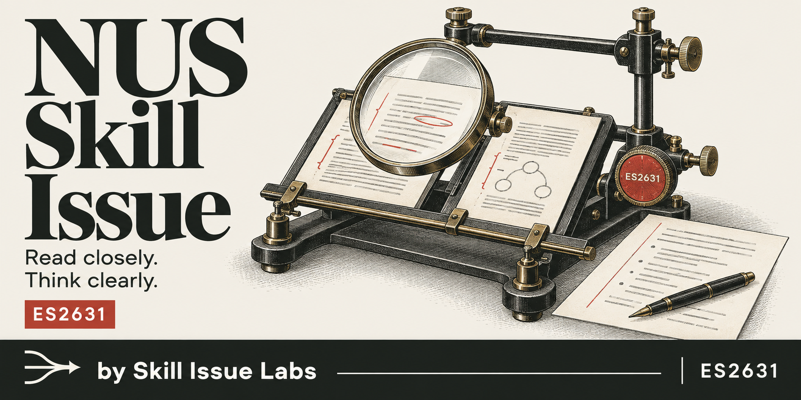
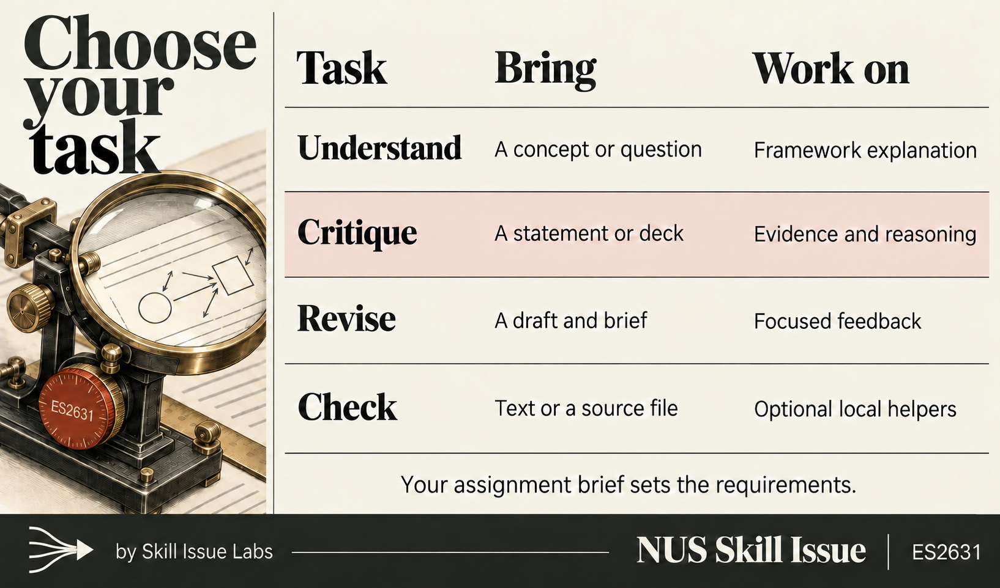

# ES2631

**Critique and Communication of Thinking and Design**

An agent skill from **[NUS Skill Issue](https://github.com/NUS-Skill-Issue) by Skill Issue Labs** for understanding the reasoning framework, critiquing evidence and improving written arguments.

Bring a question, statement, slide deck or draft. The skill connects the Elements of Thought and Intellectual Standards to your material, then helps you explain the judgement in focused prose. NUS Skill Issue publishes one skill per module, each in its own repository.

## Get started

Clone this repository, or download and extract its source archive.

```sh
git clone https://github.com/NUS-Skill-Issue/es2631.git
cd es2631
```

Give your assistant [SKILL.md](SKILL.md) and the [references folder](references/), together with your question and relevant materials. Include the current assignment brief when it sets the requirements.

```text
Use the ES2631 skill to review this paragraph against my assignment brief.
Identify the weakest inference and show one possible revision.
Keep my position and stay within 180 words.
```

If your host already recognises the installed skill, invoke `$es2631`.

```text
$es2631 Explain the difference between accuracy and logic using my design proposal.
Show how each standard tests a different part of my argument.
```

Installation and discovery depend on the host. This repository has no installer, and host installation and automatic discovery have not yet been verified.

## How it works

1. Establish the question, sources, word limit and requirements in the current brief.
2. Use the Elements of Thought to locate the claim, evidence, assumption or inference that matters.
3. Apply the relevant Intellectual Standards and check what the source actually supports.
4. Deliver the requested explanation, critique or revision, then check its scope and source support.

The [skill](SKILL.md) and [references](references/) guide the assistant through the task. They support framework tutoring, focused PEEL paragraphs and written critique. Optional Python helpers extract source text and flag passages for review.

Your current brief governs assessment scope, required standards, word limits, citations and permitted AI use. Nine paragraphs, full coverage of all eight elements and keyword quotas apply only when your task requires them.

## Choose your task



| Task | Bring | Work on |
| --- | --- | --- |
| Understand | A concept or question | Framework explanation |
| Critique | A statement or deck | Evidence and reasoning |
| Revise | A draft and brief | Focused feedback |
| Check | Text or a source file | Optional local helpers |

Ask for the output you need and name any constraints.

```text
Use the ES2631 skill to critique this deck using accuracy and fairness.
Use only the deck. Locate the strongest issue for each standard with slide numbers.
Keep each paragraph below 150 words.
```

```text
Use the ES2631 skill to review this draft for relevance.
Identify the paragraph that contributes least to my argument and explain why.
Give feedback before proposing a revision.
```

## Optional helpers

The helpers require Python 3.10 or later. From the repository root, read the available options.

```sh
python3 scripts/check_essay.py --help
python3 scripts/extract_deck.py --help
```

The checker uses the Python standard library. PowerPoint extraction needs `python-pptx`. PDF extraction uses an available `pdfplumber`, `pypdf` or `pdftotext` installation. Dependencies are not installed automatically.

For a focused paragraph check, select the relevant standards and a word limit.

```sh
python3 scripts/check_essay.py paragraphs.txt --paragraphs-only --standards accuracy,fairness --limit 300
```

`--limit` sets a hard maximum for the text being checked. `--require-all-elements` and `--style` enable optional observations. Use full element coverage only when the task requires it.

Helper output needs review. Vocabulary matches do not establish reasoning quality, and a number appearing in source text does not verify its context or accuracy. Inspect the original charts and diagrams alongside extracted text.

## What has been tested

The [recorded evaluation results](evals/RESULTS.md) cover 22 helper regression tests, structural checks and two independent behaviour cases. The helper run included synthetic PowerPoint and PDF inputs. Those integration tests skip when their optional libraries are unavailable.

The results describe the cases actually run and their limits. The broader [evaluation cases](evals/es2631.md) remain a work plan. Host integration, full semester coverage and performance against a current marking rubric have not been established.

The [official ES2631 course page](https://www.nus.edu.sg/celc/undergraduate-courses/es2631-critique-and-communication-of-thinking-and-design/) covers written critique and a team academic oral presentation. This experimental package currently focuses on written critique and framework tutoring. Dedicated presentation and teamwork guidance remain open. See [course context](references/course-context.md) and [module metadata](module.json) for sources and known gaps.

## Contribute

Bring a specific failure case and a small improvement. Use synthetic examples, explain the expected behaviour and keep source details traceable. The [helper tests](tests/test_helpers.py) and [behaviour cases](evals/es2631.md) provide starting points for checking a change.

Run the helper tests from the repository root. Optional extraction libraries determine whether the integration tests run.

```sh
PYTHONDONTWRITEBYTECODE=1 python3 -m unittest discover -s tests -v
```

For another module, start a separate repository using the [module conventions](docs/adding-a-module.md). Each module owns its skill, references and evaluations.

## Credit and license

NUS Skill Issue is an independent student project by **Skill Issue Labs**. It is not an official NUS service.

Released under the [MIT license](LICENSE). [Provenance](PROVENANCE.md) records the supplied starter, source checks and attribution. The framework authors and source references are credited in [course context](references/course-context.md). [Artwork notes](assets/README.md) describe the illustrations and their generation.
